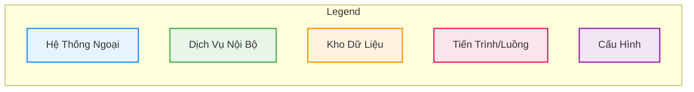
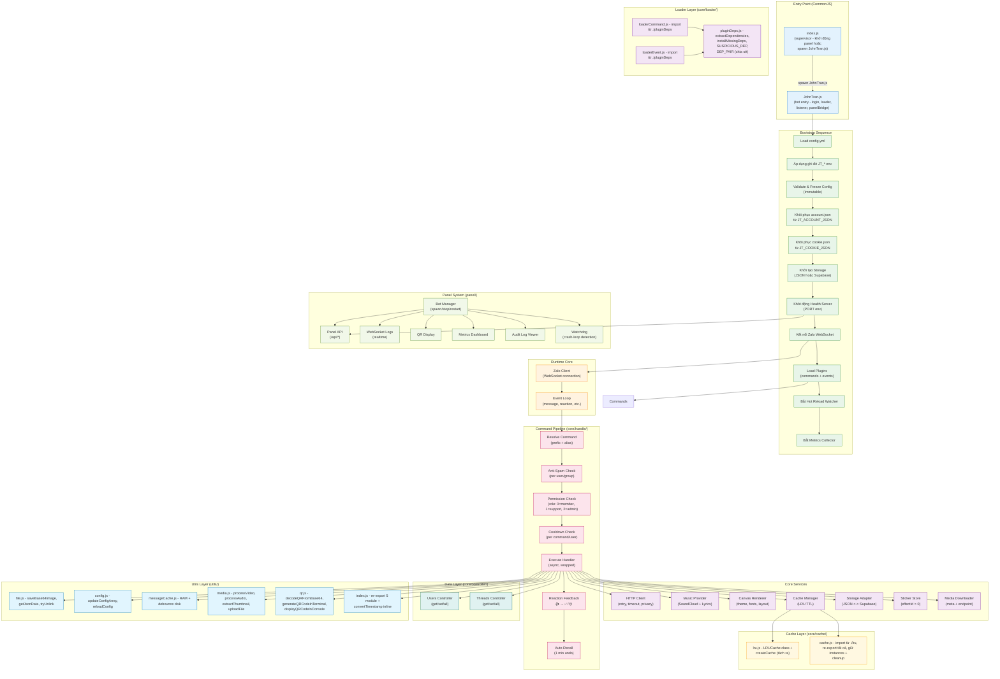
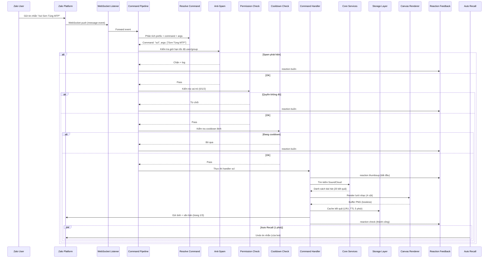
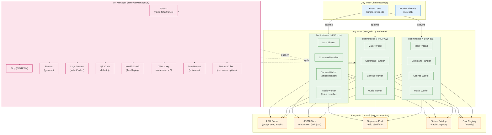

# ARCHITECTURE_COMPLETE.md

## 1. Legend



## 2. Current System Overview

```mermaid
flowchart TB
    subgraph External["Hệ Thống Ngoại"]
        Zalo["Zalo Platform
(WebSocket)"]
        SoundCloud["SoundCloud API"]
        TikTokAPI["TikTok API
(tikwm + fallback)"]
        MediaDL["Media Downloader
(endpoint tùy chọn)"]
        Supabase["Supabase
(PostgreSQL)"]
        UptimeRobot["UptimeRobot
(health ping)"]
        GitHubPages["GitHub Pages
(Panel UI)"]
        Render["Render.com
(Docker Host)"]
    end

    subgraph BotRuntime["JOHNTRAN Bot Runtime (Node.js v20+)"]
        direction TB

        subgraph Entry["Entry Point (CommonJS)"]
            Index["index.js
(supervisor)"]
            JohnTran["JohnTran.js
(bot entry, spawn)"]
        end

        subgraph Core["core/"]
            Config["config.yml + env
(JT_*) → Immutable"]
            HTTP["HTTP Client
(timeout, retry, privacy guard)"]
            Services["Services Config
(endpoints từ config)"]
            AI["AI Module
(Gemini TTS /noi)"]
            Music["Music Registry
(Track + SoundCloud + Lyrics)"]
            Message["Message Helper
(reply, card, reaction)"]
            Canvas["Canvas Renderer
(theme, vip, menu, music)"]
            Cache["LRU Cache TTL
(group, user, music)"]
            Storage["Storage Abstraction
(JSON local + Supabase)"]
            Metrics["Metrics + Audit Log
(data/audit.log)"]
            HotReload["Hot Reload
(plugin watcher)"]
            Health["Health Server
(/health endpoint)"]
            Bootstrap["Bootstrap
(account/cookie/env restore)"]
        end

        subgraph Pipeline["core/handle/"]
            Resolve["Resolve Command"]
            AntiSpam["Anti-Spam Check"]
            Permission["Permission Check
(role 0/1/2)"]
            Cooldown["Cooldown Check"]
            Execute["Execute Command"]
        end

        subgraph Loader["core/loader/"]
            CmdLoader["Command Loader"]
            EventLoader["Event Loader"]
            PluginDeps["pluginDeps.js
(extractDependencies,
installMissingDeps)"]
        end

        subgraph Utils["utils/" (tách thành 5 module)"]
            UFile["file.js
(saveBase64Image,
getJsonData, tryUnlink)"]
            UConfig["config.js
(updateConfigArray,
reloadConfig)"]
            UMsgCache["messageCache.js
(RAM + debounce disk)"]
            UMedia["media.js
(processVideo,
processAudio, ...)"]
            UQR["qr.js
(decodeQR, generateQR,
displayQR)"]
            UIndex["index.js
(re-export 35 dòng)"]
        end

        subgraph Controller["core/controller/"]
            Users["Users Controller"]
            Threads["Threads Controller"]
        end
    end

    subgraph Panel["panel/"]
        BotManager["Bot Manager
(spawn/stop/restart/logs/QR)"]
        PanelServer["Panel API Server
(zero-dep, không Express)"]
    end

    subgraph Plugins["plugins/"]
        Commands["commands/ (23 lệnh)
scl, lyric, noi, stats, menu,
spam, spamsticker, card, tiktok,
infofb, getavt, autodown, events..."]
        Events["events/ (đã bỏ v3)
Pure command-based bot"]
    end

    subgraph Assets["assets/"]
        Spam["spam/*.txt
(vi, en, zh, ja, ko, th, mix)"]
        MediaData["autosend.json
girl.json
vdgirl.json"]
        BadWords["spam/badwords.txt"]
        BG["bg/theme.jpg"]
        Fonts["fonts/ (8 family)"]
    end

    subgraph Data["data/"]
        Store["store.json
(JSON atomic store)"]
        AuditLog["audit.log"]
        CacheDir["cache/"]
    end

    subgraph RuntimeArtifacts["Runtime Artifacts (bị gitignore)"]
        CacheAssets["core/assets/cache/"]
        Session["*.session"]
        Tmp["*.tmp"]
        Scratch["*.scratch"]
    end

    Zalo ---|WebSocket| BotRuntime
    SoundCloud ---|REST| Music
    TikTokAPI ---|REST| Commands
    MediaDL ---|REST| Commands
    Supabase ---|PostgreSQL| Storage
    UptimeRobot ---|HTTP /health| Health
    GitHubPages ---|HTTPS| PanelServer
    Render ---|Docker| BotRuntime

    Index -->|spawn| JohnTran

    classDef ext fill:#e8f4fd,stroke:#2196f3;
    classDef int fill:#e8f5e9,stroke:#4caf50;
    classDef store fill:#fff3e0,stroke:#ff9800;
    classDef proc fill:#fce4ec,stroke:#e91e63;
    classDef cfg fill:#f3e5f5,stroke:#9c27b0;

    class Zalo,SoundCloud,TikTokAPI,MediaDL,Supabase,UptimeRobot,GitHubPages,Render ext
    class Config,HTTP,Services,AI,Music,Message,Canvas,Cache,Storage,Metrics,HotReload,Health,Bootstrap,Resolve,AntiSpam,Permission,Cooldown,Execute,CmdLoader,EventLoader,PluginDeps,Users,Threads,BotManager,PanelServer,UFile,UConfig,UMsgCache,UMedia,UQR,UIndex int
    class Store,AuditLog,CacheDir,Supabase store
    class Commands,Events proc
    class Spam,MediaData,BadWords,BG,Fonts cfg
    class CacheAssets,Session,Tmp,Scratch store
```

## 3. Current Internal Architecture



## 4. Request Flow



## 5. Worker Pool



## 6. Refactoring Summary

Dưới đây là tóm tắt các thay đổi refactoring đã thực hiện đối với mã nguồn JOHNTRAN-JS:

### 6.1 package.json
- `main`: `dist/index.js` → `index.js`
- `start`: `node dist/index.js` → `node index.js`
- `dev`: `ts-node src/index.ts` → `nodemon JohnTran.js`
- `start:prod`: `NODE_ENV=production node dist/index.js` → `NODE_ENV=production node JohnTran.js`
- Xóa script `build: tsc`
- Xóa `typescript` và `ts-node` khỏi `devDependencies`
- Entry point hiện là CommonJS: `index.js` (supervisor) → `JohnTran.js` (bot)

### 6.2 .gitignore
- Thêm các runtime artifacts vào danh sách bỏ qua: `core/assets/cache/`, `*.session`, `*.tmp`, `*.scratch`

### 6.3 Xóa file rác
- `core/music/index.js.bak`
- `scripts/benchmark.py`
- `write_bench.py`
- `deploy/edge/*.py` (4 file)
- `scripts/__dbg.js`
- `scripts/_smoke_monitor.js`
- `scripts/_fix-sticker.js`
- `fix.js`

### 6.4 core/loader/pluginDeps.js (mới)
- Tạo module chia sẻ cho cài đặt dependency của plugin
- Xuất: `extractDependencies`, `installMissingDeps`, `SUSPICIOUS_DEP`, `DEP_PAIR`

### 6.5 core/loader/loaderCommand.js
- Xóa code trùng lặp `extractDependencies`, `SUSPICIOUS_DEP`, `DEP_PAIR`
- Nhập từ `./pluginDeps`

### 6.6 core/loader/loaderEvent.js
- Xóa code trùng lặp `extractDependencies`, `SUSPICIOUS_DEP`, `DEP_PAIR`
- Nhập từ `./pluginDeps`

### 6.7 core/cache/lru.js (mới)
- Tách lớp `LRUCache` và hàm `createCache` ra module riêng

### 6.8 core/cache.js
- Nhập `{ LRUCache, createCache }` từ `./lru` và re-export tất cả
- Giữ nguyên tất cả cache instances và hàm cleanup

### 6.9 utils/ (chia utils/index.js 455 dòng thành 5 module + index re-export 35 dòng)
- `utils/file.js` - `saveBase64Image`, `getJsonData`, `tryUnlink`
- `utils/config.js` - `updateConfigArray`, `reloadConfig`
- `utils/messageCache.js` - message cache (RAM + debounce disk)
- `utils/media.js` - `processVideo`, `processAudio`, `extractThumbnail`, `uploadFile`, v.v.
- `utils/qr.js` - `decodeQRFromBase64`, `generateQRCodeInTerminal`, `displayQRCodeInConsole`
- `utils/index.js` - re-export từ 5 module trên + hàm `convertTimestamp` giữ nguyên inline

## 7. Target File Structure

```text
JOHNTRAN-JS/
├── index.js                      # Supervisor (entry point, CommonJS)
│                                  # Chế độ panel: khởi động PanelServer + BotManager
│                                  # Chế độ bot đơn: spawn JohnTran.js
├── JohnTran.js                   # Bot entry (được spawn bởi index.js)
│                                  # Login, loader, listener, panelBridge, stats
├── package.json                  # main: index.js; start: node index.js
│                                  # dev: nodemon JohnTran.js
│                                  # start:prod: NODE_ENV=production node JohnTran.js
│                                  # Không có build: tsc, không có typescript/ts-node
├── .gitignore                    # + core/assets/cache/, *.session, *.tmp, *.scratch
├── config.yml
├── .env.example
├── account.json
├── cookie.json
├── qr.png
├── tsconfig.json                 # Giữ lại (không dùng cho build)
├── nodemon.json
├── Dockerfile
├── Dockerfile.prod
├── docker-compose.prod.yml
├── render.yaml
├── core/
│   ├── bootstrap.js              # Khôi phục account/cookie/env
│   ├── cache.js                  # Import từ ./cache/lru, re-export tất cả,
│   │                               giữ instances + cleanup (threadCache, userCache, …)
│   ├── cache/
│   │   └── lru.js                # LRUCache class + createCache (đã tách ra)
│   ├── config/                   # Cấu hình hệ thống
│   ├── controller/
│   │   ├── controllerUsers.js    # Users Controller (get/set/all)
│   │   └── controllerThreads.js  # Threads Controller (get/set/all)
│   ├── handle/                   # Command pipeline (resolve, anti-spam, permission, cooldown, execute)
│   ├── health.js                 # Health Server (/health)
│   ├── hotReload.js              # Hot Reload Watcher
│   ├── listen.js                 # Zalo WebSocket listener
│   ├── login.js                  # Đăng nhập Zalo
│   ├── message.js                # Message Helper (reply, card, reaction)
│   ├── metrics.js                # Metrics + Audit Log
│   ├── monitoring.js             # Giám sát hệ thống
│   ├── panelBridge.js            # Cầu nói panel (chat Zalo thu nhỏ, localhost)
│   ├── stats.js                  # Thu thập thống kê bot
│   ├── videoMeta.js              # Thông tin video
│   ├── workerPool.js             # Quản lý worker pool
│   ├── ai/                       # AI Module (Gemini TTS /noi)
│   ├── canvas/                   # Canvas Renderer (theme, vip, menu, music)
│   ├── commands/                 # Lệnh nội bộ core
│   ├── http/                     # HTTP Client (retry, timeout, privacy guard)
│   ├── lazyLoader.js             # Preload heavy modules nền
│   ├── mediaCache.js             # Media cache
│   ├── mediaDownloader.js        # Media Downloader (meta + endpoint)
│   ├── mediaReply.js             # Trả lời media
│   ├── mentions.js               # Xử lý mentions
│   ├── music/                    # Music Registry (Track + SoundCloud + Lyrics)
│   ├── pixelfx/                  # Hiệu ứng pixel
│   ├── services.js               # Services Config
│   ├── socialFetch.js            # Lấy dữ liệu mạng xã hội
│   ├── socialInfo.js             # Thông tin mạng xã hội
│   ├── stickerConvert.js         # Chuyển đổi sticker
│   ├── stickerCreate.js          # Tạo sticker
│   ├── stickerFactory.js         # Xưởng sticker
│   ├── stickerFrames.js          # Khung sticker
│   ├── stickerStore.js           # Sticker Store (effectId > 0)
│   ├── storage/                  # Storage Abstraction (JSON local + Supabase)
│   ├── styled.js                 # Định dạng estil
│   ├── tiktok.js                 # TikTok API
│   ├── workers/                  # Worker threads
│   └── assets/
│       └── cache/                # Runtime cache (bị gitignore)
│   └── loader/
│       ├── loaderCommand.js      # Command Loader (import từ ./pluginDeps)
│       ├── loaderEvent.js        # Event Loader (import từ ./pluginDeps)
│       └── pluginDeps.js         # extractDependencies, installMissingDeps,
│                                  # SUSPICIOUS_DEP, DEP_PAIR (chia sẻ)
├── core/assets/cache/            # Bị gitignore - runtime artifacts
├── panel/
│   ├── botManager.js             # Bot Manager (spawn/stop/restart/logs/QR/watchdog)
│   └── server/                   # Panel API Server (zero-dep, không Express)
├── plugins/
│   ├── commands/                 # 23 lệnh (scl, lyric, noi, stats, menu, …)
│   └── events/                   # Đã bỏ v3 (pure command-based bot)
├── utils/
│   ├── index.js                  # 35 dòng, re-export từ 5 module + convertTimestamp inline
│   ├── file.js                   # saveBase64Image, getJsonData, tryUnlink
│   ├── config.js                 # updateConfigArray, reloadConfig
│   ├── messageCache.js           # Message cache (RAM + debounce disk)
│   ├── media.js                  # processVideo, processAudio, extractThumbnail,
│   │                               uploadFile, convertDurationToFiveDigits, convertMp3ToAac
│   ├── qr.js                     # decodeQRFromBase64, generateQRCodeInTerminal,
│   │                               displayQRCodeInConsole
│   ├── logger.js                 # Ghi log hệ thống
│   ├── db.js                     # Kết nối database
│   └── batchDb.js                # Ghi batch database
├── assets/
│   ├── spam/*.txt                # (vi, en, zh, ja, ko, th, mix)
│   ├── autosend.json
│   ├── girl.json
│   ├── vdgirl.json
│   ├── bg/theme.jpg
│   └── fonts/                    # 8 family
├── data/
│   ├── store.json                # JSON atomic store
│   ├── audit.log
│   └── cache/
├── scripts/
├── test/
├── deploy/
├── docs/
├── reference-images/
├── khung-stk/
├── native/
├── vendor/
│   └── zalo-client/
├── bots/
├── .tmp/                         # Bị gitignore
└── .tmpscratch/                  # Bị gitignore
```

Luồng khởi động: `npm start` → `index.js` (supervisor) → spawn `JohnTran.js` (bot entry). Trong chế độ panel, `index.js` khởi động `PanelServer` và `BotManager` thay vì spawn bot trực tiếp.
