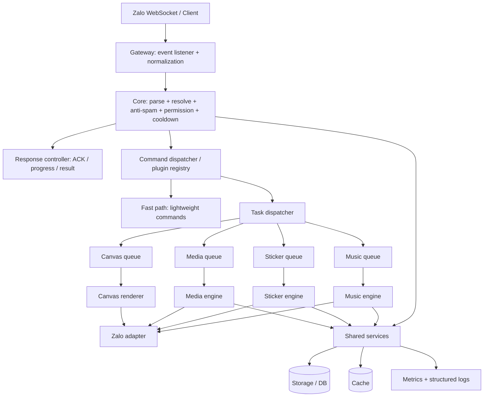

# JOHNTRAN-JS V5 — Modular Architecture & Migration Blueprint

> Status: architecture blueprint for incremental implementation.
> Base: `security/johntran-v4-hardening` (V4 hardening + V5 queue/worker work).
> Compatibility rule: preserve the existing Zalo login flow, command names, aliases, permissions, configuration keys and plugin contract.

## 1. Goals

- Keep message intake and command routing short and predictable.
- Acknowledge long-running commands before expensive work starts.
- Isolate music, sticker, media, canvas and background jobs in independent queue lanes.
- Keep Zalo API/session operations behind a single adapter boundary.
- Make failures, queue pressure, latency and resource use observable.
- Migrate incrementally; do not perform a risky one-shot rewrite or delete legacy modules before parity tests pass.

## 2. Runtime architecture



### Request lifecycle

1. Gateway receives a Zalo event and normalizes the payload once.
2. Core resolves the command and runs spam, permission, disabled-command and cooldown checks.
3. Lightweight commands execute directly; expensive commands send a short acknowledgement and enqueue work.
4. A queue lane runs the task with bounded concurrency, pending capacity, timeout and deduplication where appropriate.
5. The response controller sends the final result through the Zalo adapter.
6. Metrics record dispatch latency, queue wait, execution time, API time and outcome.

**Important:** ACK must not bypass permission checks. Do not acknowledge a command as accepted until validation succeeds and the task has actually been accepted by its queue.

## 3. Repository structure — target layout

This is the target organization, not a claim that every directory already exists.

```text
JOHNTRAN-JS/
├── index.js                         # process supervisor / public entry
├── JohnTran.js                      # current bot bootstrap; retain compatibility
├── package.json
│
├── core/
│   ├── bootstrap.js                 # runtime bootstrap
│   ├── gateway/
│   │   ├── zaloClient.js            # Zalo client boundary (migrate from login/listen)
│   │   ├── eventListener.js         # event subscription
│   │   └── normalizeEvent.js        # normalized internal event
│   ├── handle/
│   │   ├── handleEvent.js           # event dispatch compatibility
│   │   ├── handleCommand.js         # validation + command dispatch
│   │   └── handleCommandNav.js      # navigation compatibility
│   ├── commands/
│   │   ├── registry.js              # command registry / alias index
│   │   └── context.js               # stable command context
│   ├── engines/
│   │   ├── music/                   # search, resolve, download, audio, voice
│   │   ├── sticker/                 # convert, frame processing, upload
│   │   ├── media/                   # video, image, audio and metadata
│   │   ├── canvas/                  # menu, profile, music artwork
│   │   ├── group/                   # group and member operations
│   │   ├── user/                    # profile, rank and user data
│   │   └── ai/                      # AI and TTS providers
│   ├── processing/
│   │   ├── queue/                   # bounded lane queues and policies
│   │   ├── workers/                 # worker-thread entry points
│   │   ├── taskManager.js           # task lifecycle / cancellation
│   │   └── scheduler.js             # periodic jobs
│   ├── services/
│   │   ├── zalo/                    # API adapter and upload/send contracts
│   │   ├── music/                   # provider clients
│   │   ├── media/                   # download and transform adapters
│   │   └── storage/                 # JSON / Supabase abstraction
│   ├── data/
│   │   ├── controllers/             # users and threads
│   │   └── repositories/            # storage-facing repositories
│   ├── infrastructure/
│   │   ├── cache/
│   │   ├── config/
│   │   ├── errors/
│   │   ├── logger/
│   │   ├── metrics/
│   │   └── security/
│   └── utils/
│
├── plugins/
│   ├── commands/                    # keep existing command files and names
│   └── events/                      # keep existing event plugin contract
├── panel/                           # panel server and bot manager
├── assets/                          # committed static assets only
├── data/                             # persistent runtime data (never temp cache)
├── temp/                             # generated files (gitignored)
├── scripts/
└── test/
    ├── unit/
    ├── integration/
    ├── performance/
    └── regression/
```

## 4. Existing files mapped to target responsibilities

| Existing path (verified in repository) | Responsibility | Target boundary |
|---|---|---|
| `index.js`, `JohnTran.js` | supervisor and bot startup | keep as compatibility entry points |
| `core/listen.js`, `core/login.js` | Zalo login/listener | `core/gateway/` |
| `core/handle/handleEvent.js` | event routing | gateway → core dispatcher |
| `core/handle/handleCommand.js` | command checks and execution | `core/handle/` + command context |
| `core/loader/loaderCommand.js`, `loaderEvent.js` | plugin discovery/loading | plugin registry |
| `plugins/commands/*` | user-facing commands | remain in place during migration |
| `core/music/*` | music provider and command support | `core/engines/music/` + `services/music/` |
| `core/stickerConvert.js`, `stickerCreate.js`, `stickerFactory.js`, `stickerFrames.js`, `stickerStore.js` | sticker pipeline | `core/engines/sticker/` |
| `core/mediaDownloader.js`, `mediaCache.js`, `mediaReply.js`, `videoMeta.js`, `tiktok.js` | media pipeline | `core/engines/media/` |
| `core/canvas/*` | image/canvas rendering | `core/engines/canvas/` |
| `core/jobQueue.js` | bounded in-process lanes | `core/processing/queue/` |
| `core/workerPool.js`, `core/workers/*` | worker-thread execution | `core/processing/workers/` |
| `core/controller/controllerUsers.js`, `controllerThreads.js` | data access | `core/data/controllers/` |
| `core/storage/*`, `utils/db.js` | persistence | `core/services/storage/` |
| `core/cache.js`, `core/cache/lru.js`, `core/http/*` | cache and HTTP | shared infrastructure/services |
| `core/metrics.js`, `core/monitoring.js`, `core/health.js` | runtime visibility | `core/infrastructure/metrics/` |

Do not move files just to match this diagram. First introduce stable exports/facades, migrate imports, run tests, and only then remove old paths.

## 5. Engine boundaries

### Music
- Search, URL resolution, download, audio conversion and voice delivery are separate stages.
- Search and audio use separate bounded lanes.
- Text search results must not wait for decorative Canvas/Now Playing rendering.
- Verify the installed Zalo client's actual upload/send voice contract before changing audio delivery. Never invent a `sendVoice` payload.

### Sticker
- Separate source download, conversion, cache lookup and Zalo upload.
- FFmpeg/conversion work runs in a bounded worker/queue.
- Upload remains in the main process when it requires the authenticated Zalo session.
- Deduplicate identical in-flight conversions.

### Media
- Separate metadata lookup from download and transformation.
- Use provider timeouts, bounded retries and file-size limits.
- Clean temporary files in `finally` paths.

### Canvas
- Treat artwork as non-critical background work.
- A failed Canvas render must not suppress a text or media response.
- Use a separate lane so rendering cannot starve command handling.

## 6. Queue and worker rules

- Every lane defines `concurrency`, `maxPending`, timeout and optional dedupe policy.
- Backpressure must count both pending and active work when enforcing total in-flight limits.
- Priority is stable FIFO within the same priority.
- Worker assignment must reserve a worker exclusively until its task settles; round-robin selection alone is not safe when multiple jobs can attach listeners to the same worker.
- A timed-out or crashed worker is removed and replaced before reuse.
- Queue shutdown drains or rejects pending work deterministically.
- Do not create unbounded promises, child processes or FFmpeg jobs.

## 7. Command execution contract

A command module should receive a stable context rather than import global runtime state directly:

```js
{
  api,                 // authenticated Zalo adapter
  event,               // normalized event
  threadId,
  threadType,
  userId,
  args,
  commandName,
  config,
  services,
  reply,                // send / react / progress helpers
  signal                // optional AbortSignal for cancellation
}
```

Commands retain their existing exported shape until a compatibility adapter can wrap them. New commands may use the context contract immediately.

## 8. Performance and reliability objectives

These are engineering targets to measure, not claims about current production performance.

| Metric | Target |
|---|---:|
| Lightweight command dispatch | P95 ≤ 100 ms (excluding Zalo network round-trip) |
| Accepted-task acknowledgement | P95 ≤ 300 ms (excluding Zalo network round-trip) |
| Queue wait | measured per lane; alert on sustained saturation |
| Duplicate in-flight work | one execution per dedupe key |
| Cross-lane isolation | slow media work does not block music search or fast commands |
| Worker failure | bounded timeout + safe replacement |
| Compatibility | all existing command and event regression tests pass |

Track at least: `event_received_at`, `dispatch_started_at`, `queue_accepted_at`, `worker_started_at`, `worker_finished_at`, `response_sent_at`, queue depth, active workers, cache hit rate and failure category.

## 9. Migration plan

1. **Baseline:** capture current command/plugin inventory, test results and startup behavior.
2. **Compatibility facades:** introduce gateway, command registry and service boundaries without moving legacy files.
3. **Processing hardening:** fix worker reservation, in-flight limits, timeout cleanup and queue shutdown; add concurrency tests.
4. **Engine extraction:** migrate Music and Sticker first, then Media and Canvas; keep old import paths as facades.
5. **Remaining domains:** Group, User and AI modules move only after dependency boundaries are verified.
6. **Cleanup:** remove deprecated paths only after all imports and tests point to the new modules.
7. **Release:** run unit, integration, regression, performance and real Zalo smoke tests before merging to `main`.

## 10. Explicit non-goals

- No one-shot rewrite of the bot.
- No deletion or renaming of existing commands, aliases, config keys or data files in the architecture phase.
- No claim that a command is faster until measured.
- No change to Zalo API payloads without checking the installed client implementation and a real integration test.
- No direct commit to `main` during this migration.

## 11. Current implementation status

The repository already contains a first V5 slice: `core/jobQueue.js`, `core/workerPool.js`, audio/sticker/media/canvas workers, and queue-related tests. The architecture above organizes the next steps around those real modules; it does not imply that every target directory or engine has already been created.
