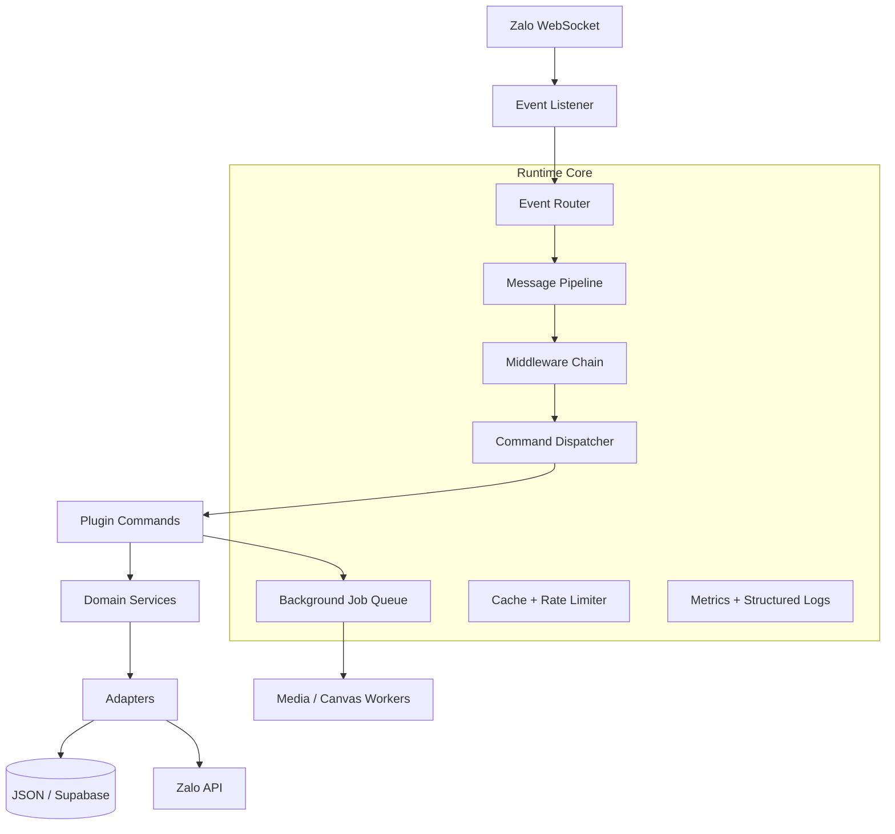

# JOHNTRAN-JS V6 — Modular Runtime Architecture

## Mục tiêu
Tái cấu trúc theo kiểu strangler migration: giữ nguyên entry point, Zalo client,
plugin contract và dữ liệu hiện tại; chuyển từng trách nhiệm sang module độc lập,
có kiểm thử, không đổi toàn bộ đường dẫn trong một lần.

## Sơ đồ mục tiêu


## Cấu trúc đích
```text
core/
  runtime/
    commandRegistry.js     # direct lookup + cached alias index
    rateLimiter.js         # sliding-window limiter, bounded memory
    dispatcher.js          # next migration step: pipeline orchestration
    middleware/            # permission, cooldown, anti-spam
  events/                  # event routing and context creation
  services/                # domain services independent of Zalo transport
  adapters/
    zalo/
    storage/
    media/
  jobs/                    # bounded background queue and workers
  observability/            # metrics, tracing, health
plugins/
  commands/                 # backward-compatible command contract
  events/
```

## Luồng xử lý
1. Listener nhận event và phân loại event.
2. Router chuyển message đến pipeline phù hợp.
3. Resolver tìm command trực tiếp; nếu không có thì tra alias index đã cache.
4. Middleware kiểm tra spam, quyền, cấu hình nhóm và cooldown.
5. Handler chạy với context tương thích: api, reply, Users, Threads.
6. Tác vụ nặng chuyển dần sang queue; event loop không chờ việc nền không cần thiết.
7. Metrics/log được ghi độc lập; lỗi handler không làm dừng listener.

## Quy tắc tương thích
- Giữ index.js -> JohnTran.js trong giai đoạn migration.
- Giữ command.config, command.run(), command.handleEvent().
- Giữ tên lệnh, alias, quyền, cooldown, prefix và data hiện có.
- Loader phải invalidate command index sau load/reload.
- Không di chuyển plugin hàng loạt trước khi có contract tests.
- Không chuyển bootstrap TypeScript chưa dùng vào runtime chính trước khi parity tests đạt.

## Đã triển khai ở giai đoạn 1
- Tách command registry khỏi handler.
- Alias được lập chỉ mục, tránh quét toàn bộ Map ở mỗi tin nhắn.
- Tách sliding-window rate limiter, không dùng Array.shift() trên từng request.
- Giữ nguyên ngưỡng: 12 lệnh / 10 giây / người dùng.
- Thêm unit tests cho direct lookup, alias invalidation và rate limiter.

## Các giai đoạn tiếp theo
- Giai đoạn 2: trích permission/cooldown middleware, giữ nguyên thứ tự kiểm tra.
- Giai đoạn 3: chuẩn hóa event context và router.
- Giai đoạn 4: tách domain services khỏi Zalo adapter.
- Giai đoạn 5: queue có giới hạn concurrency cho media/rendering và kiểm thử tải.
- Giai đoạn 6: chuyển dần bootstrap TypeScript vào runtime chính sau khi parity tests đạt.
