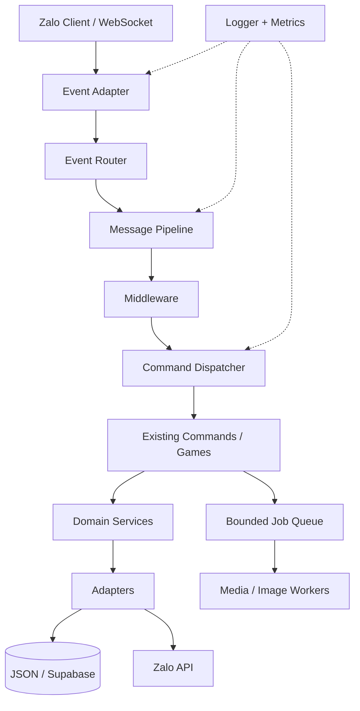

# JOHNTRAN V7 — Compact Modular Bot Architecture

## Mục tiêu

V7 là kiến trúc đích cho JOHNTRAN-JS theo hướng **modular monolith**: một tiến trình bot, các module có ranh giới rõ ràng, không chia nhỏ thành nhiều service/process khi chưa cần. Ưu tiên phản hồi nhanh, dễ bảo trì và không phá tương thích.

## Sơ đồ tổng thể



## Cấu trúc đích gọn

```text
JOHNTRAN-JS/
├── index.js                 # supervisor / process entry
├── JohnTran.js              # bot bootstrap (giữ tương thích)
├── core/
│   ├── runtime/
│   │   ├── commandRegistry.js
│   │   ├── rateLimiter.js
│   │   ├── dispatcher.js
│   │   └── middleware/
│   │       ├── permissions.js
│   │       ├── cooldown.js
│   │       └── groupPolicy.js
│   ├── events/              # chuẩn hóa event + router
│   ├── services/            # nghiệp vụ không phụ thuộc Zalo
│   ├── adapters/            # Zalo, storage, media
│   ├── jobs/                # queue + workers
│   ├── handle/              # compatibility facade trong giai đoạn chuyển đổi
│   ├── loader/
│   └── controller/          # data access hiện hữu, migrate dần
├── plugins/
│   ├── commands/            # giữ nguyên tên lệnh / aliases / contract
│   └── events/
├── games/                   # domain game sau khi migrate từ core/games
├── data/                    # giữ nguyên schema và vị trí dữ liệu hiện tại
├── assets/
├── config/
├── test/
└── docs/
```

> Đây là cấu trúc đích theo từng giai đoạn. Không tạo hàng loạt thư mục rỗng hoặc di chuyển file chỉ để khớp sơ đồ. Những phần đang chạy ổn tiếp tục ở vị trí cũ cho đến khi có adapter và kiểm thử tương thích.

## Luồng xử lý chuẩn

1. Zalo adapter nhận event, chuẩn hóa context tối thiểu.
2. Router phân loại message, reaction, member và group event.
3. Message pipeline parse prefix và resolve command bằng registry đã cache.
4. Middleware kiểm tra anti-spam, quyền bot/nhóm, chính sách nhóm và cooldown.
5. Dispatcher gọi handler theo contract hiện tại: `command.run({ args, event, api, Users, Threads, replyData, reply, mentions, threadData, userData })`.
6. Tác vụ nặng như tải video, tạo ảnh và render được chuyển sang queue có giới hạn concurrency.
7. Logger/metrics ghi nhận độc lập; lỗi một command không được làm dừng listener.

## Quy tắc không được phá vỡ

- Giữ `index.js -> JohnTran.js` và chế độ panel/bot đơn.
- Giữ nguyên tên command, aliases, prefix, role, cooldown, `handleEvent`, `onLoad`.
- Giữ nguyên đường dẫn và schema dữ liệu người dùng, nhóm, kinh tế và game.
- Không đổi thứ tự các bước kiểm tra quyền nếu chưa có test tương đương.
- Không chạy tác vụ nặng đồng bộ trong event listener.
- Queue phải có giới hạn kích thước, concurrency và chính sách lỗi.
- Không xóa controller/handler cũ cho đến khi mọi consumer đã chuyển và parity tests đạt.

## Tiến độ triển khai

### V6 — Runtime foundation
- Command registry: lookup trực tiếp trước, alias index cache sau.
- Sliding-window rate limiter, giới hạn số key trong bộ nhớ.
- Giữ ngưỡng 12 lệnh / 10 giây / người dùng.
- Unit tests cho registry và limiter.

### V7 — Runtime modules (đợt hiện tại)
- Tách kiểm tra role và group policy ra `core/runtime/middleware/permissions.js`.
- Tách consume cooldown ra `core/runtime/middleware/cooldown.js`.
- Thêm `core/runtime/eventRegistry.js`: index subscription theo event type, giữ thứ tự event plugin trước command `handleEvent`, cache và invalidate khi hot reload.
- Tách gọi command, reaction trạng thái và cô lập lỗi sang `core/runtime/dispatcher.js`.
- Handler cũ gọi middleware/dispatcher mới; giữ nguyên command contract và lớp tương thích.
- Thêm `core/runtime/services/userService.js` và `threadService.js` làm ranh giới nghiệp vụ; hiện ủy quyền cho controller cũ để giữ nguyên schema/cache.
- Handler và loader dùng service facade mới, nhưng plugin vẫn nhận đúng API `Users`/`Threads` hiện có.
- Có unit tests riêng cho quyền, cooldown, event registry, dispatcher và domain service facade.

### Các đợt tiếp theo
1. Chuẩn hóa event context và router, nhưng giữ listener cũ làm adapter.
2. Tách dispatcher khỏi transport handler, giữ nguyên command contract.
3. Mở rộng domain services cho kinh tế / tu tiên / cộng đồng; chuyển logic ra khỏi controller theo từng nhóm, không đổi schema dữ liệu.
4. Tách Zalo API và storage thành adapters.
5. Chuyển media/render sang bounded queue và worker.
6. Chỉ sau khi parity tests đạt mới di chuyển thư mục hoặc xóa compatibility facade.

## Kiểm thử bắt buộc trước khi merge

- `npm ci`
- `npm test`
- `node scripts/test-commands.js`
- `node scripts/test-all.js`
- Kiểm tra hot reload command, alias, quyền admin/support, giới hạn nhóm, cooldown và command Tu Tiên.
